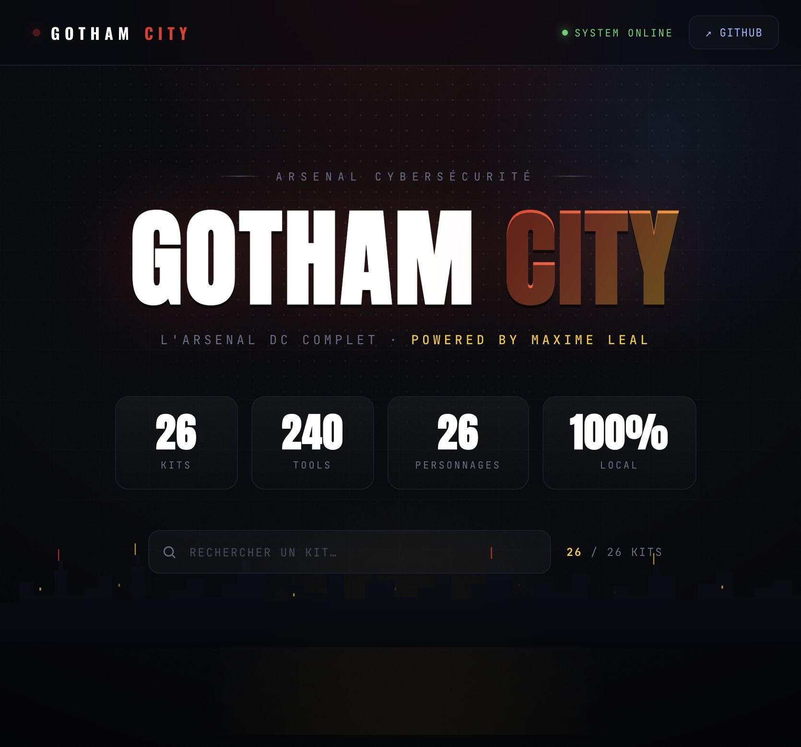

<div align="center">

# 🦇 GOTHAM CITY — L'ARSENAL DC

**27 kits · 249 outils · 1 interface web**

Un arsenal de cybersécurité complet, habillé aux couleurs de l'univers DC Comics.
Développé de A à Z en Python — interface web embarquée, générateur de documentation
statique, pipeline d'images automatisé.

[](https://maximeleal.github.io/tool_DC-arsenal/)
[](https://github.com/MaximeLEAL/tool_DC-arsenal)
[](https://www.python.org/)



</div>

---

## 🌆 Le projet

**Gotham City** est le poste de commande de l'arsenal : une interface web unique
qui référence les **26 kits** et les **245 outils** du projet. Chaque outil a sa
fiche explicative — rôle, fonctionnement, utilisation — avec redirection vers le
code source.

| | |
|---|---|
| 🕸️ **Interface web** | serveur HTTP embarqué (Python stdlib, zéro dépendance), design custom : skyline animée, cartes 3D tilt au curseur, recherche live |
| 📄 **Documentation générée** | un pipeline parse le catalogue (`liste_tool.md`) et génère 245 fiches + 26 pages de kits automatiquement |
| 🌍 **Publication** | site statique sur GitHub Pages, reconstruit en une commande (`build_site.py`) |
| 🖼️ **Pipeline d'images** | 27 visages de personnages DC téléchargés en HD (API DC Database + Wikipedia), recadrés au pixel près, optimisés web |
| 🔬 **Périmètre** | laboratoire isolé : machines perso, VMs, participants CTF uniquement |

## 🧩 Les 26 kits

| # | Kit | Rôle |
|---|-----|------|
| 01 | 🟢 RickPortal | kit malware complet (keylogger, reverse shell, ransomware, worms, screenspy, webcam, micro) |
| 02 | ⚡ Flash Tool_Super | 55 outils · builder macOS/Windows, droppers, OSINT, réseau |
| 03 | 🦇 BatCave | 31 outils d'investigation (forensics, crypto, sniffer, dark web, gadgets) |
| 04 | 🃏 Joker Chaos | pranks visuels inoffensifs |
| 05 | 🔱 Trident Aquaman | réseau : débit live, Wake-on-LAN, scans |
| 06 | 🦸 Superman Vision | radiographie système : disque, CPU, détection IOCs |
| 07 | 🕯️ Constantine | dark web : Tor, onions, BTC, moteur de fuites |
| 08 | 🪢 Lasso Vérité | vérification : hashes, TLS, emails, métadonnées |
| 09 | 🤖 Cyborg Tech | intégration : APIs, webhooks, JSON, automatisation |
| 10 | 🏢 LexCorp | arsenal Windows : injection DLL, hollowing, crypter |
| 11 | 🔬 S.T.A.R. Labs | C2 DNS + HTTP, agent, anti-analysis |
| 12 | 🎯 Task Force X | déploiement : SSH worm, module Android |
| 13 | 💊 Neo / La Matrice | 10 outils de la Matrice |
| 14 | 🌟 La Force | archive système, infiltrator, sweeps, crypto |
| 15 | 🐱 Catwoman | secrets : trousseau, navigateurs, DPAPI, clés API |
| 16 | 🍯 H.I.V.E. | minage : PoW réel, xmrig, coordonnateur de flotte |
| 17 | 🎃 Scarecrow | phishing : 12 miroirs de login, tunnel, viewer live |
| 18 | ⚔️ WarWorld | arsenal de 110 armes / 16 thèmes |
| 19 | 🥷 Ligne Rouge | orchestrateur de campagne : plan → run → rapport |
| 20 | 🟩 Kryptonite Suite | défense : scanner IOCs, règles Sigma, YARA |
| 21 | 🎮 W.O.P.R. | auto-lab CTF inspiré WarGames : cible vulnérable + scoreboard |
| 22 | 📊 The Calculator | breach analytics : stats et timeline des grandes fuites |
| 23 | 🐦‍⬛ Raven | évasion EDR : syscalls directs, unhooking, ETW/AMSI, sleep obfuscation |
| 24 | 🧠 The Thinker | reverse engineering : analyse statique/dynamique, radare2 |
| 25 | 🂡 Joker Card | BadUSB : payloads, firmware ducky-lite, gestionnaire web |
| 26 | 📰 Daily Planet | veille : 25 sources, 644 actus, dashboard filtrable, digest 8h + push téléphone |
| 27 | 🕸️ BatWeb | 3 apps web : forensics email, stégano studio, carte réseau vivante |

## 🚀 Démarrage

```bash
# cloner
git clone https://github.com/MaximeLEAL/tool_DC-arsenal.git
cd tool_DC-arsenal

# lancer l'interface
python3 gotham_full.py 9000
# → http://127.0.0.1:9000
```

```bash
# regénérer la documentation statique (245 fiches + site)
python3 generate_all_pages.py   # fiches tools → arsenal_web_pages/
python3 build_site.py           # site complet → docs/ (publié sur GitHub Pages)
```

## 🏗️ Architecture

```
tool_DC/
├── gotham_full.py            # serveur web embarqué (interface + API + statique + apps /app/)
├── batweb.py                 # les 3 apps web : forensics email, stégano studio, carte réseau
├── generate_all_pages.py     # générateur des 245 fiches tools (parse liste_tool.md)
├── build_site.py             # build du site statique → docs/ → GitHub Pages
├── liste_tool.md             # LA source de vérité : catalogue des 26 kits
├── design_preview/           # template du design (page principale)
├── arsenal_web_pages/        # 245 fiches + 26 index de kits (généré)
├── arsenal_pages_data/       # données JSON des kits (pour le serveur)
├── gotham_static/            # visages HD + recadrage automatisé (crop_hd.py)
├── <26 dossiers de kits>/    # le code de chaque kit
└── docs/                     # site publié (GitHub Pages)
```

## 🛠️ Stack

**Python 3** (stdlib uniquement pour le serveur) · **HTML/CSS/JS vanilla**
(framework-free) · **sips** (pipeline d'images macOS) · **GitHub Actions + Pages**
(CI/CD et hébergement) · **Cloudflare** (tunnels d'accès distant) ·
**mingw-w64** (cross-compilation Windows depuis macOS)

## ⚖️ Périmètre & éthique

Projet développé dans un cadre **de laboratoire isolé et de formation** :
machines personnelles, VMs dédiées, participants CTF volontaires. Aucun usage
contre des systèmes tiers. La suite défensive (Kryptonite Suite) détecte les
IOCs de tous les kits de l'arsenal — chaque technique offensive documentée a
sa contre-mesure.

---

<div align="center">

**GOTHAM CITY · 27 KITS · 249 TOOLS** · *powered by Maxime Leal*

[🌐 Site](https://maximeleal.github.io/tool_DC-arsenal/) · [📦 Code](https://github.com/MaximeLEAL/tool_DC-arsenal)

</div>
